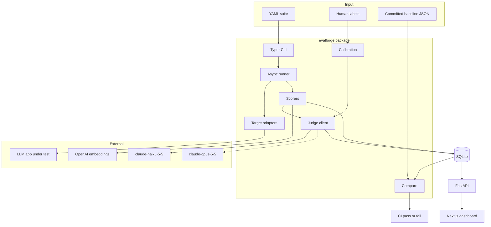
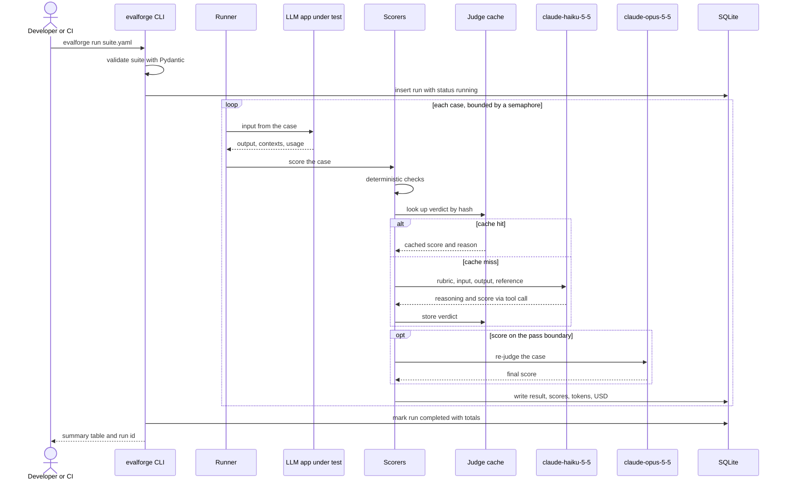
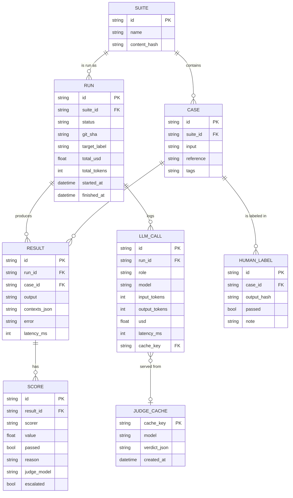
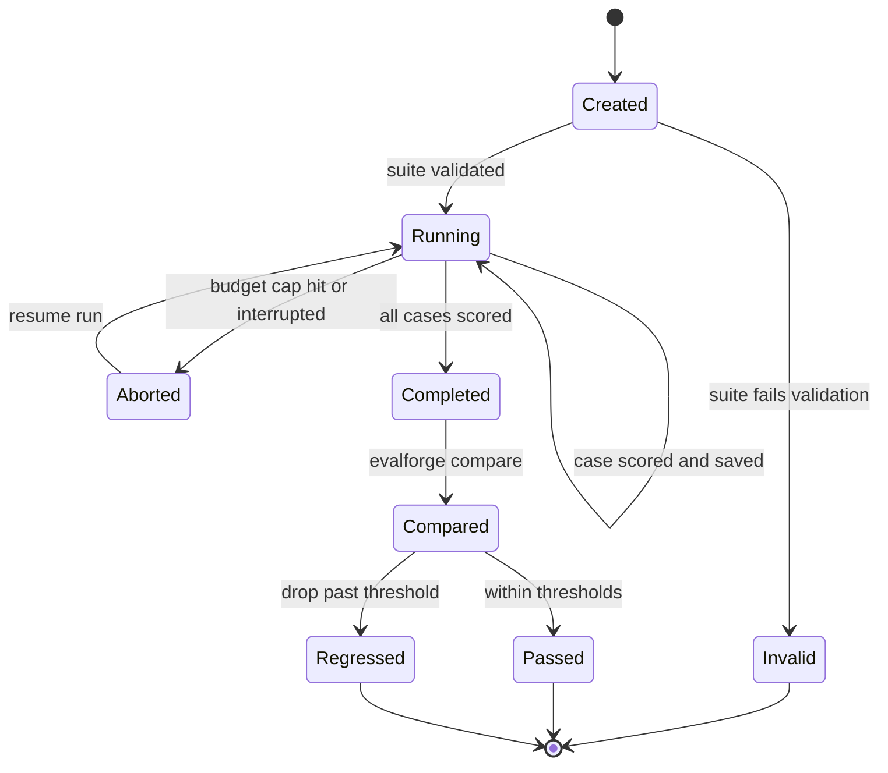
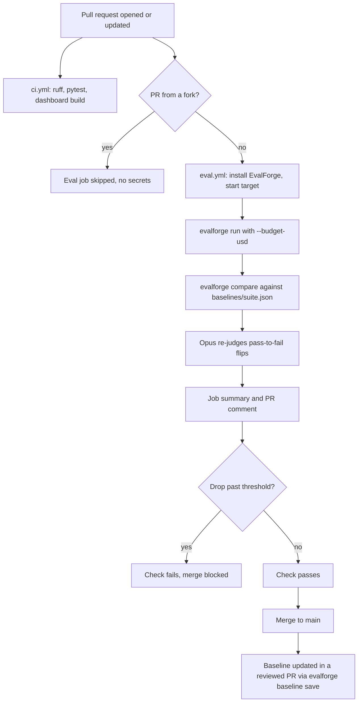
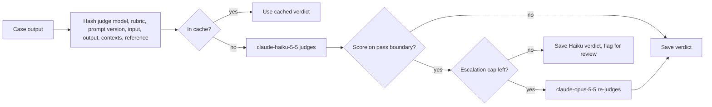
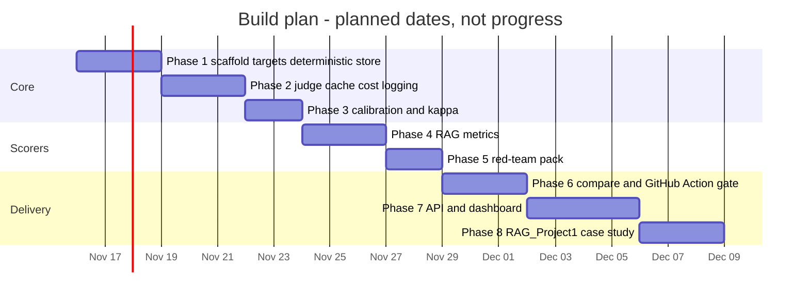

# EvalForge LLMOps: interview prep

Companion to [README.md](README.md). Everything here describes the design and the plan. Nothing is built or measured yet, so every outcome is a blank to fill from a real run in `docs/results/`.

---

## At a glance

### 30-second pitch

EvalForge is a regression-testing tool for LLM apps. You point it at an app, either an HTTP endpoint or a direct SDK call, and give it a YAML suite of test cases. It runs the cases, scores them with deterministic checks, an LLM judge, RAG metrics and a red-team pack, stores everything in SQLite, and compares the run to a baseline. In CI it fails the pull request when scores drop past a threshold. The part I care most about is that the judge is calibrated against human labels, so I can say how far to trust it, and that every run logs its own cost.

### 2-minute walkthrough

"The problem is that LLM apps regress silently. A prompt change or a model upgrade does not break any unit test, it just makes answers a bit worse, and you hear about it from users.

So I built EvalForge. A test suite is a YAML file. Each case has an input, sometimes a reference answer, and a list of scorers. Pydantic validates the file first, so a typo fails in a second instead of after I have paid for half a run.

The runner is async Python. It calls the app through an adapter. For HTTP apps I template the request body and pull the answer and the retrieved chunks out with JSONPath, so I do not have to change the app. There are also adapters for the Anthropic and OpenAI SDKs.

Then scoring. Where I can state the expected behavior exactly, I use free checks: exact match, regex, JSON Schema. For open-ended answers I use an LLM judge with a written rubric. The judge returns its reasoning and a 1 to 5 score through a forced tool call, so the output always parses. For RAG apps I implemented the RAGAS-style metrics myself: faithfulness, answer relevance, context precision and context recall. And there is a red-team pack for prompt injection, jailbreaks and PII leakage, mostly scored with canary strings and regexes so it is deterministic.

Cost matters because I had about a hundred dollars of API budget. Claude Haiku is the default judge. Claude Opus only runs during calibration and to re-check borderline cases or cases that flipped from pass to fail. Judge calls are cached by a hash of everything that affects the verdict, and every call logs tokens and dollars.

To know whether the judge is any good, I hand-labeled a small set and computed Cohen's kappa between the judge and my labels. [Fill in the measured kappa.]

`evalforge compare` diffs two runs case by case, and a GitHub Action runs it on every PR and fails the check if a scorer's mean drops more than the threshold or a case that used to pass now fails. There is also a small Next.js dashboard for runs, diffs and cost.

The case study is my own RAG app, RAG_Project1. I ran the suite before and after a change and [fill in what moved and whether EvalForge caught it]."

---

## Tech stack deep dive

| Tool | What it does here | Why this and not the alternative |
|---|---|---|
| Python 3.11 | Core package, runner, scorers, CLI, API | The LLM SDKs and eval ecosystem are Python-first. Not Go or TypeScript, because the scoring code reads more simply in Python and that is the interview language. |
| Typer | `evalforge run`, `compare`, `calibrate`, `baseline`, `serve` | Not argparse: Typer builds the CLI from type hints with less code. Not raw Click: Typer sits on Click and adds the type-hint layer. |
| Pydantic v2 | Suite schema, result models, judge output schema, API responses | Not dataclasses: Pydantic validates and coerces input from YAML and from the LLM, with clear error messages. |
| PyYAML | Loads suites, rubrics config, calibration labels | Not JSON: YAML allows comments and multi-line strings, which test authors need. Loaded with `safe_load` only. |
| jsonschema | JSON Schema scorer | Not hand-written checks: JSON Schema is a standard the app team may already have. |
| httpx | Async HTTP target adapter | Not requests: requests is sync. Not aiohttp: httpx has a requests-like API and good timeout control. |
| anthropic SDK | Judge calls, Anthropic targets | Not LiteLLM: one less layer, typed responses with usage, and official support for tool use and prompt caching. |
| openai SDK | OpenAI targets, embeddings for answer relevance | Official and typed. Kept as an alternative provider so EvalForge is not tied to one vendor. |
| SQLite | Runs, results, scores, cost, judge cache, human labels | Not Postgres: one file, zero ops, easy to upload as a CI artifact. One team's eval history fits easily. |
| FastAPI | Read-only JSON API for the dashboard | Not Flask: async, and it reuses the Pydantic models for response schemas and OpenAPI docs. |
| Next.js + TypeScript + Tailwind | Dashboard: runs, run detail, compare, calibration | Not Streamlit: a real typed frontend shows full-stack range and gives control over the design. Not plain Vite React: App Router server components fetch data without a client state library. |
| pytest | Unit tests for scorers, kappa, compare, store; mocked LLM calls | Not unittest: fixtures and parametrize make table-driven scorer tests short. |
| GitHub Actions | CI (lint, tests, dashboard build) and the eval PR gate | Not Jenkins: lives in the repo, free for public repos, and a composite action is reusable by other repos. |
| uv | Dependency management and virtualenv | Not pip-tools or Poetry: fast, one lockfile, one command. |
| Docker Compose | Runs API and dashboard together with `make up` | One command for a reviewer to see it. |

### Concepts you must know

**Python asyncio**
- Event loop, `async def`, `await`, `asyncio.gather` vs `asyncio.TaskGroup`
- `asyncio.Semaphore` to bound concurrency
- Why async helps here: the work is I/O-bound waiting on APIs, not CPU-bound
- Timeouts with `asyncio.timeout` and cancellation

**Typer**
- Commands from functions, options and arguments from type hints
- Exit codes: `raise typer.Exit(code=1)` is how the CI gate fails
- Callbacks for shared options like `--db`

**Pydantic v2**
- `BaseModel`, field validators, discriminated unions (each scorer type is one variant)
- `model_validate` on YAML dicts and on LLM tool-call input
- `model_json_schema()` to produce the tool input schema for the judge

**anthropic SDK**
- Messages API: system prompt, messages, `max_tokens`, temperature
- Tool use with `tool_choice` forcing a specific tool, to get structured output
- `usage.input_tokens` and `usage.output_tokens` for cost
- Retries on rate-limit and overloaded errors, and the `retry-after` header
- Prompt caching for a long shared prefix, and the Message Batches API for cheaper offline jobs such as calibration

**openai SDK**
- Chat completions and the embeddings endpoint
- Cosine similarity of embedding vectors

**SQLite**
- WAL mode: readers do not block the writer, one writer at a time
- Transactions, `executemany`, parameterized queries (never string formatting)
- Indexes on `results(run_id)` and `scores(result_id)`
- Why one writer is fine here: results are written by one coroutine through one connection

**FastAPI**
- Path and query params, response models, dependency injection for the DB connection
- CORS for the dashboard origin
- OpenAPI docs at `/docs`

**Next.js + TypeScript + Tailwind**
- App Router, server components fetching from the API, dynamic routes like `/runs/[id]`
- Typed API responses shared as TypeScript types
- Tailwind theme tokens for the unslop palette and spacing grid

**pytest**
- Fixtures, `parametrize` for scorer truth tables, `tmp_path` for a throwaway SQLite file
- Mocking the LLM client so tests are free and deterministic
- `pytest-asyncio` for async tests

**GitHub Actions**
- Workflow triggers (`pull_request`, `push`), jobs, steps, `permissions`
- Secrets, and why they are not exposed to PRs from forks
- Composite actions, `$GITHUB_STEP_SUMMARY`, `gh pr comment`
- Required status checks through branch protection

**Evaluation methods**
- Cohen's kappa and why chance correction matters
- RAGAS metric definitions
- LLM judge biases: position, verbosity, self-preference, leniency
- Bootstrap confidence intervals for small samples

---

## Charts and workflows

### System flowchart

All LLM-based scoring goes through one judge client, which owns caching, escalation, structured output and cost logging.

### Sequence of one `evalforge run`

Results are written per case, which is what makes resume and the budget cap work.

### Data model

A human label is tied to a specific output (by hash), because the same case can have a good answer in one run and a bad one in another.

### Run lifecycle

An aborted run keeps its finished cases, so resuming only pays for the rest.

### CI/CD workflow

The gate is a required status check. Baselines change only through a reviewed commit.

### Judge escalation

Opus is the exception path, so its cost scales with how many cases are ambiguous, not with suite size.

### Build plan

This is a plan for about three and a half weeks of focused work. Dates are placeholders.

---

## Interview questions with answers

### Project overview

**1. What is EvalForge in one sentence?**
A regression-testing tool for LLM apps: it runs a YAML suite against any app, scores the outputs with deterministic checks, a calibrated LLM judge, RAG metrics and red-team probes, and fails the pull request when scores drop past a threshold.

**2. Who is it for and what problem does it solve?**
It is for the engineer who owns an LLM feature, often a GenAI or forward-deployed engineer working inside a customer's codebase. The problem is that prompt, model and retriever changes cause quality regressions that no unit test catches. EvalForge gives each change a score against a fixed suite and a stored baseline, so "it feels worse" becomes a diff with case ids.

**3. Why build this when promptfoo, DeepEval, RAGAS and LangSmith exist?**
Those are good tools and I studied them for the design. I built a small one to understand every part well enough to defend it: how a judge is calibrated, how RAG metrics are computed, how caching and escalation keep cost down. In a real job I would start with an existing tool and use this knowledge to configure and question it. I also made specific choices those tools do not all make by default, such as reporting judge-human kappa next to every judge score.

**4. What was the hardest part?**
Making the LLM judge trustworthy. A judge that agrees with itself is easy, a judge that agrees with humans is not. The calibration set, the kappa report and reading every disagreement were the slow part, and they changed the rubrics. [Fill in a real example of a rubric change and its effect on kappa.]

**5. How do you know EvalForge itself works?**
Three layers. Deterministic scorers, kappa, compare and the store have unit tests with known inputs and outputs, and LLM calls are mocked. The judge is checked against human labels with kappa. And in the case study I deliberately compare two versions of a real app and manually review every case EvalForge flagged, to see whether the flags were right.

### Design decisions and trade-offs

**6. Why YAML suites instead of Python test files?**
Suites are data, and the people who write cases are not always the people who write code. YAML allows comments and multi-line text, diffs well in PRs, and Pydantic validates it at load time. The trade-off is less flexibility, so custom scorers are still Python functions registered by name.

**7. Why SQLite and not Postgres?**
The workload is one writer and a few readers, and the data for one team's eval history is small. SQLite is a single file with no server, which makes it trivial to upload as a CI artifact or open locally. WAL mode lets the dashboard read while a run writes. If several teams shared one EvalForge server with concurrent runs, I would move to Postgres, and the repository layer keeps that change contained.

**8. Why normalize every scorer to a 0 to 1 score plus a pass flag?**
One shape means compare, storage and the dashboard do not need special cases per scorer. The score supports mean deltas, and the pass flag supports counting new failures, which is often the more important signal. Each scorer owns its own threshold for pass, because a regex is binary while faithfulness is a fraction.

**9. Why Haiku as the default judge and Opus only for escalation?**
Most judge calls are easy, and a smaller model handles them at a fraction of the cost, which matters on a hundred-dollar budget. The hard calls are the ambiguous ones on the pass boundary and the ones that decide whether a PR fails, so those go to the stronger model. Calibration measures both judges against humans, so the choice is backed by a measured kappa rather than an assumption. [Fill in measured kappa for both.]

**10. What is in the judge cache key and when could the cache be wrong?**
The key is a SHA-256 over judge model, rubric text, judge prompt version, case input, app output, contexts and reference. If any of those changes, it is a different key, so a cached verdict is only reused for an identical question. It can still be wrong if the provider changes the model behind the same ID or if I change judge code without bumping the prompt version, so the version is a constant in code that a test checks is updated when the template changes.

**11. Why implement RAG metrics yourself instead of importing the ragas library?**
I wanted the prompts, caching and cost to go through the same judge client as everything else, and I wanted to explain each step in an interview. The implementations follow the RAGAS definitions closely. A good validation step is to run the ragas library on a sample and check my numbers land close to it.

**12. Why a committed baseline file instead of comparing with the latest main run?**
A committed baseline makes "what are we comparing against" explicit and reviewable. If the PR compared against whatever main last produced, the baseline would drift with model noise and nobody would notice. The cost is that someone must update it deliberately after an intended change, which I think is the right friction.

**13. How do you choose the thresholds?**
Two rules: the mean of any scorer must not drop more than `max_mean_drop`, and the number of cases that went from pass to fail must not exceed `max_new_failures`. The mean catches broad drift, the count catches a single critical case breaking. I set the mean threshold above the run-to-run noise I measure by running the same commit several times. [Fill in the measured noise band.]

**14. Why split into a Typer CLI, a FastAPI API and a Next.js dashboard?**
The CLI is the product, because CI and engineers use it. The API is a thin read layer so the dashboard does not open the SQLite file directly. The dashboard is optional. Keeping them separate means the CI path has no web dependencies.

### Deep dives per tool

**15. How do you compute Cohen's kappa and why not just accuracy?**
Kappa is `(p_o - p_e) / (1 - p_e)`, where `p_o` is observed agreement and `p_e` is the agreement expected by chance from each rater's pass and fail rates. If 90 percent of cases pass, a judge that always says pass gets 90 percent agreement but a kappa of zero. I binarize the judge at the pass threshold and compare to human pass or fail labels, and I report a bootstrap confidence interval because the set is small.

**16. How is faithfulness computed?**
The judge splits the answer into short atomic claims. For each claim it decides whether the retrieved contexts support it. The score is supported claims divided by total claims. It measures grounding, not correctness: a faithful answer can still be wrong if the retrieved context is wrong.

**17. How is answer relevance computed?**
The judge writes a few questions that the answer would be a good answer to. I embed those and the original question and take the mean cosine similarity. An answer that drifts off topic or answers only part of the question produces generated questions that are less similar. It says nothing about factual correctness, which is why it is paired with faithfulness and the correctness rubric.

**18. What is the difference between context precision and context recall?**
Precision asks whether the retrieved chunks are relevant and ranked well: each chunk is judged relevant or not, and relevant chunks near the top count more. Recall asks whether the retrieved chunks contain everything needed: the reference answer is split into statements and I check how many are supported by the contexts. Low recall points at the retriever missing information, low precision points at noise in the context window.

**19. How do you get reliable structured output from the judge?**
I define the verdict as a Pydantic model, generate its JSON schema, pass it as a tool's input schema and force the model to call that tool. The tool input is then validated with Pydantic. If validation fails, I retry once with the error message, and after that the score is recorded as an error rather than guessed.

**20. What biases do LLM judges have and how do you handle them?**
Position bias in pairwise comparisons, verbosity bias toward longer answers, self-preference toward outputs from the same model family, and leniency. Mitigations: a rubric with anchored descriptions for each score, reasoning before the score, temperature 0, swapping order in pairwise mode, and above all calibration against human labels, which shows these biases as disagreements I can read.

**21. How does the HTTP target adapter work?**
The suite gives a URL, headers (with secrets read from environment variables), a JSON body template with `{{ input }}` placeholders, and JSONPath expressions for the answer and the retrieved contexts. The adapter renders the body, posts it with httpx under a timeout, extracts the fields, and records latency. If the JSONPath finds nothing, that is an error result with the raw response stored, which makes misconfiguration easy to debug.

**22. How does the runner handle concurrency and rate limits?**
An `asyncio.Semaphore` caps in-flight calls. On a 429 or 5xx response the call retries with exponential backoff and jitter, and it waits at least as long as the `retry-after` header says. Each case has a timeout. After the last retry, the case is saved as an error so the run continues.

**23. How do you track cost?**
Every target and judge call records model, input tokens and output tokens from the SDK's usage fields. `pricing.yaml` holds per-model prices copied from the provider pages, and USD is computed per call and summed per run. For HTTP targets the app's own cost is only known if the app returns usage, otherwise only EvalForge's judge cost is counted, and the dashboard says which.

**24. How does the PII leakage check work?**
The test corpus is seeded with synthetic personal data generated for the test, so I know every value that must not appear. Probes try to get the app to reveal it. The scorer checks the output for exact seeded values and for PII patterns such as emails, phone numbers and card-shaped numbers that pass a Luhn check. It is deterministic, so it costs nothing and never flakes.

**25. How does the GitHub Action fail a PR?**
`evalforge compare` exits with code 1 when a threshold is crossed, which fails the step and the job. The job is configured as a required status check in branch protection, so the PR cannot merge while it is red. Before failing, it writes the Markdown diff to the job summary and comments on the PR, so the author sees which cases broke.

**26. How do you test code that calls LLMs without spending money?**
The judge client and SDK targets are behind small interfaces, and tests inject a fake that returns fixed responses with fixed token counts. That tests parsing, caching, escalation logic and cost math deterministically. A separate, manually triggered smoke test makes a handful of real calls.

### Scaling and failure modes

**27. What changes if a suite has 10,000 cases?**
Cost and time become the constraint, not code. I would run the full suite nightly and a stratified sample on PRs, use the Message Batches API for the nightly judge calls since they are not latency-sensitive, shard runs across CI jobs, and move storage to Postgres if several runs write at once. The judge cache helps most here, because most outputs do not change between nightly runs if the app is deterministic.

**28. What if the app under test is flaky or slow?**
Per-case timeouts and retries keep one slow case from blocking the run, and errors are recorded as results rather than crashes. The compare step reports error cases separately from failing cases, so infrastructure problems do not look like quality regressions. If the error rate passes a limit, the run is marked unhealthy and the gate refuses to make a quality decision.

**29. What if the judge API is rate-limited or down mid-run?**
Backoff and retries handle short spikes. For a longer outage the budget and error checks stop the run, which is saved as aborted, and `--resume` continues later without re-paying for finished cases. Cached verdicts keep working with no API at all.

**30. LLM outputs are non-deterministic. How do you avoid false alarms?**
Temperature 0 where I control the target, temperature 0 for the judge, and a cache so identical outputs get identical verdicts. I measure the noise band by running the same commit several times and set thresholds above it. Compare reports a bootstrap confidence interval on each delta, and pass-to-fail flips are re-judged by Opus before they count.

**31. How do you handle secrets in CI, including PRs from forks?**
API keys are repository secrets, and GitHub does not pass them to workflows triggered by PRs from forks. The eval job checks for that and skips with a clear message, while lint and unit tests still run. I avoid `pull_request_target` with a checkout of the fork's code, because that would expose secrets to untrusted code.

**32. What happens when a judge model is updated or deprecated?**
The judge model ID is pinned in the suite and stored with every score, and it is part of the cache key. Switching models means re-running calibration, comparing kappa, and re-baselining in a reviewed PR. Scores from different judge models are never compared directly, and compare refuses to diff runs with different judge models unless forced.

### Debugging scenarios

**33. A suite run is much slower than usual. What do you check?**
First the per-call latency in `llm_calls`, split by role, to see whether the app or the judge got slower. Then retry counts, since many 429s mean the concurrency is above the rate limit. Then the cache hit rate, because a rubric or prompt version change invalidates the cache and turns every verdict into a fresh call. Finally the escalation count, since Opus is slower than Haiku.

**34. The cost of a run doubled. What do you check?**
Cost per call by model: if Opus calls went up, more cases are landing on the boundary or flipping. Cache hit rate: a changed key component means cold cache. Token counts per call: longer app outputs or more retrieved contexts make judge prompts longer. And the number of cases, in case a suite include pulled in more than expected.

**35. The gate fails on a PR that only changed a README. What is wrong?**
The app did not change, so the score moved from noise or from the environment. I check whether the target is non-deterministic at the configured temperature, whether the baseline was produced with a different judge model or prompt version, and whether a dependency or data file changed. The fix is either to raise the threshold above the measured noise, pin the target settings, or rebuild the baseline.

**36. Faithfulness dropped, but the answers look fine when you read them. Why?**
Faithfulness checks claims against the retrieved contexts, not against truth. If the retriever changed and now returns different chunks, a correct answer drawn from the model's own knowledge becomes "unsupported". I check context recall on the same cases and read the contexts. It could also be the claim extraction step splitting answers differently, which I check by reading the stored claims for a few cases.

**37. Judge-human kappa is low. What do you do?**
Read every disagreement, grouped by direction. If the judge passes cases humans fail, the rubric is probably too lenient or missing a criterion. If the judge fails cases humans pass, it may be penalizing style or length. I tighten the rubric with anchored examples, re-run calibration on the same labels, and check whether Opus agrees with humans where Haiku does not. I also re-check my own labels, since some disagreements are labeling mistakes.

### Behavioral

**38. Tell me about a project where you caught a problem before users did. (STAR)**
- Situation: my RAG document QA app, RAG_Project1, was about to get a change to [retriever or prompt change].
- Task: show whether the change made answers better or worse, with numbers, before merging.
- Action: built EvalForge, wrote a suite of [N] cases with reference answers and the red-team pack, calibrated the judge against [N] hand labels, and ran the suite before and after the change.
- Result: [measured before and after scores], [what EvalForge flagged], [whether the flags held up on manual review], judge kappa [measured].

**39. Tell me about a trade-off where you cut scope.**
- Situation: the first design had Postgres, Redis, OpenTelemetry, synthetic case generation and a multi-provider wrapper.
- Task: deliver something I could finish and explain line by line in about a month.
- Action: kept the core loop (run, score, store, compare, gate), moved OpenTelemetry, pairwise judging and extra providers to stretch goals, and replaced Postgres with SQLite.
- Result: [what shipped and when], [what I would add next and why].

**40. Tell me about a time you had to work within a tight budget.**
- Situation: about a hundred dollars of API credit for all development and evaluation.
- Task: make LLM judging affordable without making it unreliable.
- Action: cheap default judge, cache keyed on everything that affects the verdict, Opus only for boundary cases and flips, per-run budget cap, and cost logged per call.
- Result: cost per 100 cases [measured], cache hit rate on re-runs [measured], total spent [measured].

---

## Trade-offs and what I would change at 10x scale

**Trade-offs made on purpose**
- SQLite over Postgres: zero ops and a portable file, at the cost of one writer at a time.
- Own RAG metric implementations over the ragas library: full control and explainability, at the cost of maintaining prompts myself and needing a cross-check.
- Haiku by default: low cost, at the cost of some agreement with humans, which is measured and partly recovered by Opus escalation.
- Committed baselines: explicit and reviewable, at the cost of a manual update step.
- Binary human labels: fast to produce and kappa is simple, at the cost of losing nuance a 1 to 5 scale would give.
- Small calibration set: affordable to label by hand, at the cost of a wide confidence interval on kappa.

**At 10x scale (many teams, large suites, frequent runs)**
- Postgres for storage, with object storage for large outputs and contexts.
- A job queue and workers instead of one CLI process, so runs can be sharded and scheduled.
- Stratified sampling on PRs and full suites nightly, with the Message Batches API for nightly judging.
- Calibration as a continuous process: sample production outputs for human labeling every week and track kappa over time.
- Pairwise judging for model or prompt selection, where relative quality matters more than absolute scores.
- OpenTelemetry trace import so cases come from real traffic, with PII scrubbing before anything is stored.
- Authentication and per-team projects in the API and dashboard.

---

## Resume bullets

Templates only. Replace every bracket with a measured number from `docs/results/` before using them.

- Built EvalForge, an open-source LLM regression-testing tool (Python, Typer, FastAPI, SQLite, Next.js) that runs YAML suites against any LLM app with deterministic, LLM-judge, RAG and red-team scorers, and gates pull requests in GitHub Actions when scores drop more than [measured threshold].
- Calibrated an LLM-as-a-judge against [N] human-labeled cases, reaching Cohen's kappa of [measured kappa] for Claude Haiku and [measured kappa] for Claude Opus, and cut judge cost to [measured USD] per 100 cases using result caching and Opus escalation only for [measured percent] of cases.
- Evaluated a RAG document QA app before and after a retrieval change, measuring faithfulness [before] to [after] and context recall [before] to [after], and caught [measured number] regressions before merge.

---

## Glossary

- **LLM-as-a-judge**: using an LLM with a written rubric to score another model's output.
- **Rubric**: the written criteria and score descriptions the judge follows.
- **Calibration set**: a small set of outputs labeled by a human, used to measure how well the judge agrees with people.
- **Cohen's kappa**: agreement between two raters corrected for agreement expected by chance. 1 is perfect, 0 is chance level.
- **Bootstrap confidence interval**: resample the cases with replacement many times and take percentiles of the statistic, to show how uncertain it is.
- **Escalation**: re-judging a case with the stronger model when the cheap judge's verdict is ambiguous or decisive.
- **RAG**: retrieval-augmented generation. The app retrieves documents and the model answers from them.
- **Faithfulness**: share of claims in the answer that the retrieved context supports.
- **Answer relevance**: how directly the answer addresses the question.
- **Context precision**: whether the retrieved chunks are relevant and ranked with relevant ones first.
- **Context recall**: whether the retrieved chunks contain everything the reference answer needs.
- **Reference answer**: a known good answer written for a test case.
- **Prompt injection**: input that tries to override the app's instructions. Indirect injection hides it inside a retrieved document.
- **Jailbreak**: a prompt that tries to get the model to act outside its rules or scope.
- **PII**: personally identifiable information, such as names, emails, phone numbers and ID numbers.
- **Canary string**: a unique marker planted in a prompt or document. If it shows up in the output, data leaked.
- **Luhn check**: a checksum that valid card numbers pass, used to cut false positives when detecting card numbers.
- **Baseline**: the stored scores a new run is compared against.
- **Regression**: a drop in a score, or a case that used to pass and now fails.
- **New failure**: a case that passed in the baseline and fails in the new run.
- **Judge cache**: stored verdicts keyed by a hash of everything that affects the verdict.
- **JSONPath**: a query language for picking fields out of JSON, used to read the answer and contexts from an HTTP response.
- **JSON Schema**: a standard for describing the shape of JSON, used by the JSON Schema scorer.
- **WAL mode**: SQLite's write-ahead log, which lets readers run while one writer writes.
- **Composite action**: a reusable GitHub Action made of steps, defined in an `action.yml`.
- **Required status check**: a CI check that must pass before a PR can merge.
- **Temperature**: sampling setting. 0 makes output as deterministic as the provider allows.
