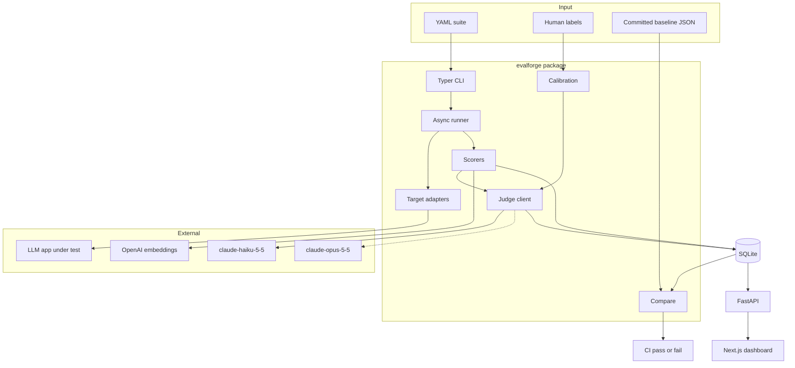
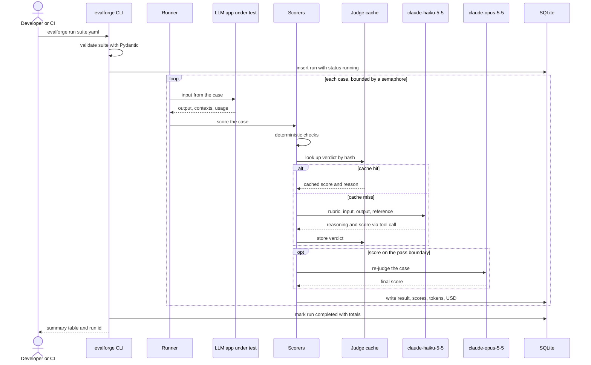
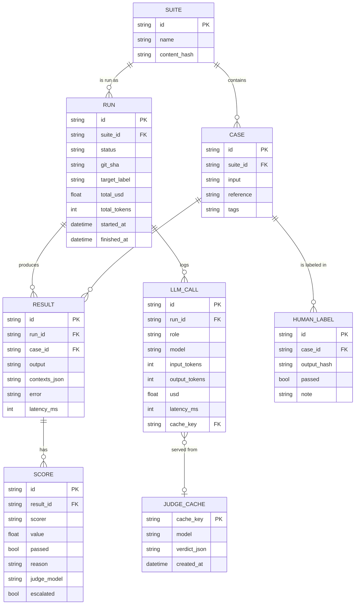
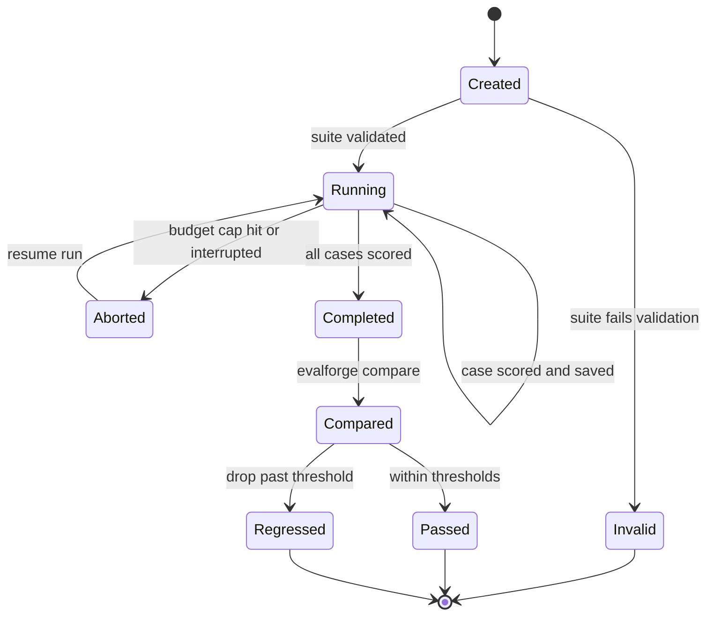
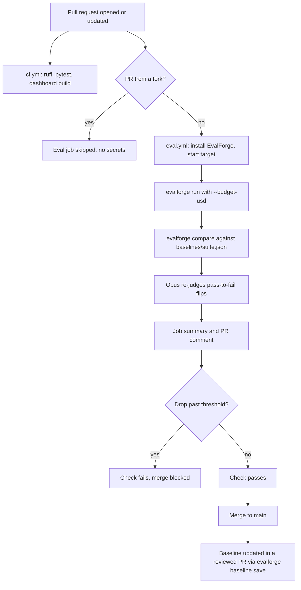
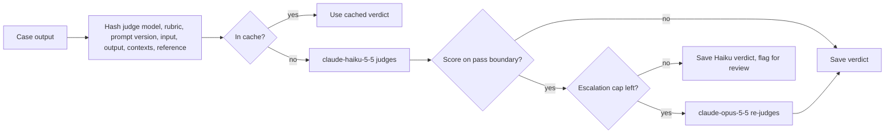
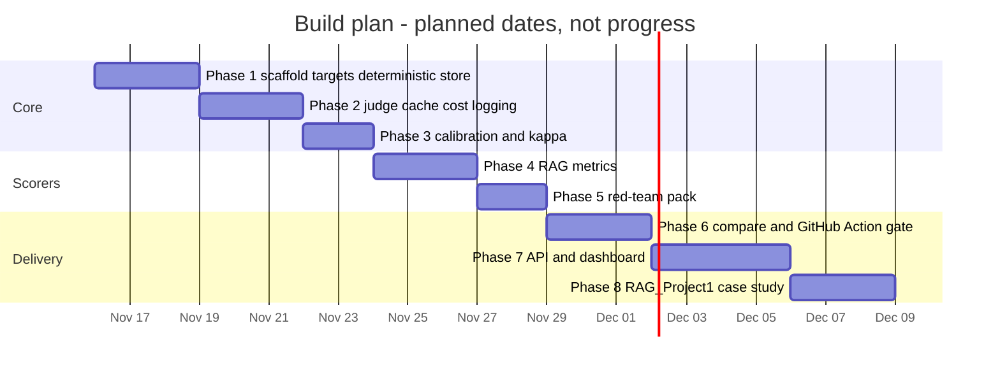

# EvalForge LLMOps: overview, system design and workflow

Companion to [README.md](README.md). Pitches, interview questions and resume bullets are in [INTERVIEW.md](INTERVIEW.md). Everything here describes the design and the plan; where a number belongs it stays a placeholder until a real run fills it in `docs/results/`.

---

## Overview

"The problem is that LLM apps regress silently. A prompt change or a model upgrade does not break any unit test, it just makes answers a bit worse, and you hear about it from users.

So I built EvalForge. A test suite is a YAML file. Each case has an input, sometimes a reference answer, and a list of scorers. Pydantic validates the file first, so a typo fails in a second instead of after I have paid for half a run.

The runner is async Python. It calls the app through an adapter. For HTTP apps I template the request body and pull the answer and the retrieved chunks out with JSONPath, so I do not have to change the app. There are also adapters for the Anthropic and OpenAI SDKs.

Then scoring. Where I can state the expected behavior exactly, I use free checks: exact match, regex, JSON Schema. For open-ended answers I use an LLM judge with a written rubric. The judge returns its reasoning and a 1 to 5 score through a forced tool call, so the output always parses. For RAG apps I implemented the RAGAS-style metrics myself: faithfulness, answer relevance, context precision and context recall. And there is a red-team pack for prompt injection, jailbreaks and PII leakage, mostly scored with canary strings and regexes so it is deterministic.

Cost matters because I had about a hundred dollars of API budget. Claude Haiku is the default judge. Claude Opus only runs during calibration and to re-check borderline cases or cases that flipped from pass to fail. Judge calls are cached by a hash of everything that affects the verdict, and every call logs tokens and dollars.

To know whether the judge is any good, I hand-labeled a small set and computed Cohen's kappa between the judge and my labels. [Fill in the measured kappa.]

`evalforge compare` diffs two runs case by case, and a GitHub Action runs it on every PR and fails the check if a scorer's mean drops more than the threshold or a case that used to pass now fails. There is also a small Next.js dashboard for runs, diffs and cost.

The case study is my own RAG app, RAG_Project1. I ran the suite before and after a change and [fill in what moved and whether EvalForge caught it]."

---

## Tech stack deep dive

| Tool | What it does here | Why this and not the alternative |
|---|---|---|
| Python 3.11 | Core package, runner, scorers, CLI, API | The LLM SDKs and eval ecosystem are Python-first. Not Go or TypeScript, because the scoring code reads more simply in Python and that is the interview language. |
| Typer | `evalforge run`, `compare`, `calibrate`, `baseline`, `serve` | Not argparse: Typer builds the CLI from type hints with less code. Not raw Click: Typer sits on Click and adds the type-hint layer. |
| Pydantic v2 | Suite schema, result models, judge output schema, API responses | Not dataclasses: Pydantic validates and coerces input from YAML and from the LLM, with clear error messages. |
| PyYAML | Loads suites, rubrics config, calibration labels | Not JSON: YAML allows comments and multi-line strings, which test authors need. Loaded with `safe_load` only. |
| jsonschema | JSON Schema scorer | Not hand-written checks: JSON Schema is a standard the app team may already have. |
| httpx | Async HTTP target adapter | Not requests: requests is sync. Not aiohttp: httpx has a requests-like API and good timeout control. |
| anthropic SDK | Judge calls, Anthropic targets | Not LiteLLM: one less layer, typed responses with usage, and official support for tool use and prompt caching. |
| openai SDK | OpenAI targets, embeddings for answer relevance | Official and typed. Kept as an alternative provider so EvalForge is not tied to one vendor. |
| SQLite | Runs, results, scores, cost, judge cache, human labels | Not Postgres: one file, zero ops, easy to upload as a CI artifact. One team's eval history fits easily. |
| FastAPI | Read-only JSON API for the dashboard | Not Flask: async, and it reuses the Pydantic models for response schemas and OpenAPI docs. |
| Next.js + TypeScript + Tailwind | Dashboard: runs, run detail, compare, calibration | Not Streamlit: a real typed frontend shows full-stack range and gives control over the design. Not plain Vite React: App Router server components fetch data without a client state library. |
| pytest | Unit tests for scorers, kappa, compare, store; mocked LLM calls | Not unittest: fixtures and parametrize make table-driven scorer tests short. |
| GitHub Actions | CI (lint, tests, dashboard build) and the eval PR gate | Not Jenkins: lives in the repo, free for public repos, and a composite action is reusable by other repos. |
| uv | Dependency management and virtualenv | Not pip-tools or Poetry: fast, one lockfile, one command. |
| Docker Compose | Runs API and dashboard together with `make up` | One command for a reviewer to see it. |

### Concepts you must know

**Python asyncio**
- Event loop, `async def`, `await`, `asyncio.gather` vs `asyncio.TaskGroup`
- `asyncio.Semaphore` to bound concurrency
- Why async helps here: the work is I/O-bound waiting on APIs, not CPU-bound
- Timeouts with `asyncio.timeout` and cancellation

**Typer**
- Commands from functions, options and arguments from type hints
- Exit codes: `raise typer.Exit(code=1)` is how the CI gate fails
- Callbacks for shared options like `--db`

**Pydantic v2**
- `BaseModel`, field validators, discriminated unions (each scorer type is one variant)
- `model_validate` on YAML dicts and on LLM tool-call input
- `model_json_schema()` to produce the tool input schema for the judge

**anthropic SDK**
- Messages API: system prompt, messages, `max_tokens`, temperature
- Tool use with `tool_choice` forcing a specific tool, to get structured output
- `usage.input_tokens` and `usage.output_tokens` for cost
- Retries on rate-limit and overloaded errors, and the `retry-after` header
- Prompt caching for a long shared prefix, and the Message Batches API for cheaper offline jobs such as calibration

**openai SDK**
- Chat completions and the embeddings endpoint
- Cosine similarity of embedding vectors

**SQLite**
- WAL mode: readers do not block the writer, one writer at a time
- Transactions, `executemany`, parameterized queries (never string formatting)
- Indexes on `results(run_id)` and `scores(result_id)`
- Why one writer is fine here: results are written by one coroutine through one connection

**FastAPI**
- Path and query params, response models, dependency injection for the DB connection
- CORS for the dashboard origin
- OpenAPI docs at `/docs`

**Next.js + TypeScript + Tailwind**
- App Router, server components fetching from the API, dynamic routes like `/runs/[id]`
- Typed API responses shared as TypeScript types
- Tailwind theme tokens for the unslop palette and spacing grid

**pytest**
- Fixtures, `parametrize` for scorer truth tables, `tmp_path` for a throwaway SQLite file
- Mocking the LLM client so tests are free and deterministic
- `pytest-asyncio` for async tests

**GitHub Actions**
- Workflow triggers (`pull_request`, `push`), jobs, steps, `permissions`
- Secrets, and why they are not exposed to PRs from forks
- Composite actions, `$GITHUB_STEP_SUMMARY`, `gh pr comment`
- Required status checks through branch protection

**Evaluation methods**
- Cohen's kappa and why chance correction matters
- RAGAS metric definitions
- LLM judge biases: position, verbosity, self-preference, leniency
- Bootstrap confidence intervals for small samples

---

## System design and workflows

### System flowchart

All LLM-based scoring goes through one judge client, which owns caching, escalation, structured output and cost logging.

### Sequence of one `evalforge run`

Results are written per case, which is what makes resume and the budget cap work.

### Data model

A human label is tied to a specific output (by hash), because the same case can have a good answer in one run and a bad one in another.

### Run lifecycle

An aborted run keeps its finished cases, so resuming only pays for the rest.

### CI/CD workflow

The gate is a required status check. Baselines change only through a reviewed commit.

### Judge escalation

Opus is the exception path, so its cost scales with how many cases are ambiguous, not with suite size.

### Build plan

This is a plan for about three and a half weeks of focused work. Dates are placeholders.

---

## Trade-offs and what I would change at 10x scale

**Trade-offs made on purpose**
- SQLite over Postgres: zero ops and a portable file, at the cost of one writer at a time.
- Own RAG metric implementations over the ragas library: full control and explainability, at the cost of maintaining prompts myself and needing a cross-check.
- Haiku by default: low cost, at the cost of some agreement with humans, which is measured and partly recovered by Opus escalation.
- Committed baselines: explicit and reviewable, at the cost of a manual update step.
- Binary human labels: fast to produce and kappa is simple, at the cost of losing nuance a 1 to 5 scale would give.
- Small calibration set: affordable to label by hand, at the cost of a wide confidence interval on kappa.

**At 10x scale (many teams, large suites, frequent runs)**
- Postgres for storage, with object storage for large outputs and contexts.
- A job queue and workers instead of one CLI process, so runs can be sharded and scheduled.
- Stratified sampling on PRs and full suites nightly, with the Message Batches API for nightly judging.
- Calibration as a continuous process: sample production outputs for human labeling every week and track kappa over time.
- Pairwise judging for model or prompt selection, where relative quality matters more than absolute scores.
- OpenTelemetry trace import so cases come from real traffic, with PII scrubbing before anything is stored.
- Authentication and per-team projects in the API and dashboard.

---

## Glossary

- **LLM-as-a-judge**: using an LLM with a written rubric to score another model's output.
- **Rubric**: the written criteria and score descriptions the judge follows.
- **Calibration set**: a small set of outputs labeled by a human, used to measure how well the judge agrees with people.
- **Cohen's kappa**: agreement between two raters corrected for agreement expected by chance. 1 is perfect, 0 is chance level.
- **Bootstrap confidence interval**: resample the cases with replacement many times and take percentiles of the statistic, to show how uncertain it is.
- **Escalation**: re-judging a case with the stronger model when the cheap judge's verdict is ambiguous or decisive.
- **RAG**: retrieval-augmented generation. The app retrieves documents and the model answers from them.
- **Faithfulness**: share of claims in the answer that the retrieved context supports.
- **Answer relevance**: how directly the answer addresses the question.
- **Context precision**: whether the retrieved chunks are relevant and ranked with relevant ones first.
- **Context recall**: whether the retrieved chunks contain everything the reference answer needs.
- **Reference answer**: a known good answer written for a test case.
- **Prompt injection**: input that tries to override the app's instructions. Indirect injection hides it inside a retrieved document.
- **Jailbreak**: a prompt that tries to get the model to act outside its rules or scope.
- **PII**: personally identifiable information, such as names, emails, phone numbers and ID numbers.
- **Canary string**: a unique marker planted in a prompt or document. If it shows up in the output, data leaked.
- **Luhn check**: a checksum that valid card numbers pass, used to cut false positives when detecting card numbers.
- **Baseline**: the stored scores a new run is compared against.
- **Regression**: a drop in a score, or a case that used to pass and now fails.
- **New failure**: a case that passed in the baseline and fails in the new run.
- **Judge cache**: stored verdicts keyed by a hash of everything that affects the verdict.
- **JSONPath**: a query language for picking fields out of JSON, used to read the answer and contexts from an HTTP response.
- **JSON Schema**: a standard for describing the shape of JSON, used by the JSON Schema scorer.
- **WAL mode**: SQLite's write-ahead log, which lets readers run while one writer writes.
- **Composite action**: a reusable GitHub Action made of steps, defined in an `action.yml`.
- **Required status check**: a CI check that must pass before a PR can merge.
- **Temperature**: sampling setting. 0 makes output as deterministic as the provider allows.
