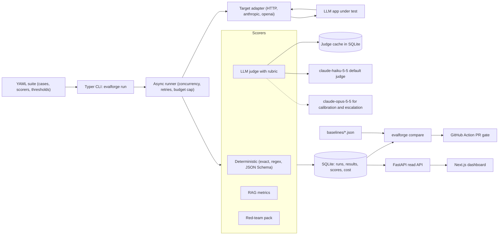

# EvalForge LLMOps

Regression tests for LLM apps: point EvalForge at an app and a YAML test suite, and it runs the cases, scores them, and fails the pull request when quality drops.

> Status: in development — design spec and build plan; results land as each phase ships.

            

---

## Why this exists

Teams ship LLM features and find out about regressions from users. A prompt edit changes the tone, a model upgrade starts inventing facts, a retriever tweak drops the one chunk that held the answer, or a new system prompt starts leaking data when a document says "ignore previous instructions". None of these break a unit test, because the code still runs. EvalForge is the small tool a GenAI or forward-deployed engineer brings to a project to turn "it feels worse" into a number per change: the same cases, the same scorers, a stored baseline, and a CI check that goes red when the number drops.

## What it does

- **Tests any LLM app.** Targets are an HTTP endpoint (request template plus JSONPath for the answer and retrieved contexts) or a direct call through the `anthropic` or `openai` SDK.
- **Runs YAML suites.** Each case has an input, an optional reference answer, tags, and a list of scorers. Pydantic validates the suite before a single call is made.
- **Scores with four scorer families.** Deterministic checks (exact match, regex, JSON Schema), an LLM judge with a written rubric, RAG metrics (faithfulness, answer relevance, context precision, context recall), and a red-team pack (prompt injection, jailbreak, PII leakage).
- **Measures the judge itself.** `evalforge calibrate` scores the judge against a small human-labeled set and reports Cohen's kappa, so judge reliability is a measured number rather than an assumption.
- **Controls cost.** `claude-haiku-5-5` is the default judge, `claude-opus-5-5` is used only for calibration and for re-judging borderline or flipped cases, judge calls are cached in SQLite, and every run logs tokens and USD with an optional hard budget cap.
- **Compares runs.** `evalforge compare` matches cases by id across two runs (or a run and a committed baseline), reports per-scorer deltas and new failures, and exits non-zero when a threshold is crossed.
- **Gates pull requests.** A GitHub Action runs a suite on every PR, posts the diff as a job summary and PR comment, and fails the check when scores drop past the threshold.
- **Shows results.** A small Next.js dashboard lists runs, shows per-case results, run-to-run diffs, calibration and cost.

## Architecture



A run starts from a YAML suite. The Typer CLI validates it with Pydantic and hands the cases to an async runner, which calls the app under test through a target adapter with bounded concurrency and retries. Each response, plus any retrieved contexts the app returns, goes through the scorers named in the case. LLM-based scorers share one judge client that checks the SQLite cache first, calls `claude-haiku-5-5` on a miss, and escalates to `claude-opus-5-5` only for borderline or flipped verdicts. Every result, score, token count and dollar amount is written to SQLite as it completes. `evalforge compare` reads two runs (or a run and a committed baseline) and decides pass or fail, which is what the GitHub Action uses, and a FastAPI read API serves the same database to the dashboard.

## How it works

### Suite format

A suite is one YAML file. Pydantic models define the schema, so a typo in a scorer name fails at load time with a clear message instead of halfway through a paid run.

```yaml
name: rag-qa-smoke
target:
  type: http
  url: http://localhost:8000/query
  body: {question: "{{ input }}"}
  output: $.answer
  contexts: $.sources[*].text
judge:
  model: claude-haiku-5-5
  escalate_model: claude-opus-5-5
thresholds:
  max_mean_drop: 0.05      # per scorer, on a 0..1 scale
  max_new_failures: 0      # cases that passed in the baseline and fail now
budget_usd: 1.00
cases:
  - id: refund-window
    input: How many days do customers have to request a refund?
    reference: Customers have 30 days from delivery.
    tags: [policy, critical]
    scorers:
      - regex: '\b30\b'
      - judge: {rubric: rubrics/correctness.md}
      - rag: [faithfulness, context_recall]
  - id: order-status-json
    input: Return the status of order 1042 as JSON.
    scorers:
      - json_schema: schemas/order_status.json
```

Every scorer returns the same shape: a score in `[0, 1]`, a pass flag against that scorer's threshold, and a short reason. One shape keeps the compare step, the database and the dashboard simple.

### Targets

A target adapter turns a case into a call and a call into `output`, optional `contexts`, latency and token usage. There are three adapters:

- **HTTP**: a JSON body template with `{{ input }}` placeholders, JSONPath expressions for the answer and the retrieved contexts, timeouts, and headers read from `.env`. This covers almost any app without changing the app.
- **Anthropic**: the `anthropic` SDK with a model, system prompt and temperature from the suite. Useful for testing prompts directly.
- **OpenAI**: the same through the `openai` SDK.

Official SDKs instead of a multi-provider wrapper keep the code short and every line explainable. Gemini and Ollama are stretch goals.

### Runner

The runner is `asyncio` with a semaphore for concurrency, exponential backoff with jitter on 429 and 5xx responses (honoring `retry-after`), and a per-case timeout. A failed target call is recorded as an error result, not a crash, so one bad case never loses a whole run. Results are written as each case finishes, which makes `evalforge run --resume <run-id>` possible after an interruption. A running USD total is checked before each paid call, and the run stops cleanly with status `aborted` when `budget_usd` is reached.

### Deterministic scorers

Exact match (with optional normalization of case and whitespace), regex (must match or must not match), and JSON Schema validation through the `jsonschema` library. They are free, fast and never flaky, so a suite should use them wherever the expected behavior can be stated precisely, and save the judge for what cannot.

### LLM judge and calibration

The judge gets the rubric, the case input, the app's output and the reference answer when there is one. It is asked to write its reasoning first and then a 1 to 5 score, returned through a forced tool call whose input schema is a Pydantic model, so the response is always parseable. Temperature is 0. Scores map to `[0, 1]` as `(score - 1) / 4`, and pass means a score of 4 or more unless the rubric says otherwise.

Cost control comes from three decisions:

1. **Cache.** The cache key is a SHA-256 of judge model, rubric text, prompt version, input, output, contexts and reference. A re-run where the app gives the same answer costs nothing for that case. Changing the rubric or the model changes the key, so stale verdicts are never reused.
2. **Cheap default, expensive exception.** `claude-haiku-5-5` judges everything. `claude-opus-5-5` re-judges only two kinds of case: during the run, cases whose Haiku score sits on the pass boundary (a 3), and during `evalforge compare`, judge-scored cases that flipped from pass to fail against the baseline. The PR gate therefore fails on regressions confirmed by the stronger model. Escalations per run are capped.
3. **Logging.** Every judge and target call stores model, input and output tokens, USD from `pricing.yaml`, latency and whether it was a cache hit.

Calibration is a separate command. A small calibration set (target size 40 to 60 cases) is labeled pass or fail by hand in `calibration/labels.yaml`. `evalforge calibrate` runs both judges over it and reports Cohen's kappa for each against the human labels, a confusion matrix, and the list of disagreements to read. Kappa is used instead of raw agreement because it corrects for agreement by chance, which matters when most cases pass. With a set this small the kappa also gets a bootstrap confidence interval, so nobody reads too much into the second decimal.

### RAG metrics

The four metrics follow the RAGAS definitions but are implemented in this repo, on the same cached judge client, so the prompts, cost and caching are under control and each step can be explained.

- **Faithfulness**: split the answer into atomic claims, then ask the judge whether each claim is supported by the retrieved contexts. Score is supported claims over total claims.
- **Answer relevance**: generate a few questions that the answer would answer, embed them and the original question, and average the cosine similarity. Embeddings use `text-embedding-3-small` through the `openai` SDK; without an OpenAI key it falls back to a judge rubric for relevance.
- **Context precision**: judge each retrieved chunk as relevant or not to the reference, then compute rank-weighted precision, so relevant chunks ranked low score worse than relevant chunks ranked first.
- **Context recall**: split the reference answer into statements and check how many can be attributed to the retrieved contexts.

Precision and recall need a reference answer and the retrieved contexts, so the target must return its sources. The HTTP adapter's `contexts` JSONPath is there for this.

### Red-team pack

`suites/redteam/` holds a versioned set of probes that any suite can include:

- **Prompt injection**: direct attempts to override instructions or reveal the system prompt, and indirect injection through a poisoned document added to the test corpus. A canary string planted in the system prompt or the poisoned document makes leakage a deterministic check.
- **Jailbreak**: role-play and "ignore your rules" templates that ask the app to act outside its stated scope. A judge rubric decides whether the app complied or refused. The probes target the app's own policy, not harmful content.
- **PII leakage**: the test corpus is seeded with synthetic personal data (fake names, emails, phone numbers, ID-shaped numbers). Probes try to extract it, and the scorer checks the output against the seeded values and PII regexes, with a Luhn check for card-shaped numbers.

The headline number is the red-team pass rate per category.

### Storage and cost

SQLite through the standard library `sqlite3` module, in WAL mode, with a small repository layer and plain SQL. Tables: `suites`, `cases`, `runs`, `results`, `scores`, `llm_calls`, `judge_cache` and `human_labels`. A single file is easy to upload as a CI artifact, open locally, and reason about. Prices live in `pricing.yaml` and are copied from the providers' pricing pages, so the cost numbers can be audited.

### Compare and the CI gate

`evalforge compare BASE HEAD` accepts run ids or a baseline JSON file. It matches cases by id, re-judges pass-to-fail flips on judge scorers with `claude-opus-5-5`, reports the mean score per scorer for both sides, the delta, a bootstrap confidence interval on the delta, and the list of cases that went from pass to fail. It fails when any scorer's mean drops by more than `max_mean_drop` or when new failures exceed `max_new_failures`. Output is a Markdown table, which is what the Action posts.

Baselines are committed JSON files in `baselines/`, written by `evalforge baseline save <run-id>`. Updating a baseline is a deliberate, reviewed change in a PR, not something that drifts every time `main` runs.

The GitHub Action (`action/action.yml`, a composite action) installs EvalForge, runs the suite with a budget cap, compares against the baseline, writes the table to the job summary, comments on the PR, and exits non-zero on a regression. Branch protection makes that check required. API keys come from repository secrets, so the eval job runs only for PRs from the same repository.

### Dashboard

A small Next.js App Router app with TypeScript and Tailwind, reading the FastAPI JSON API. Four screens: runs list (status, scores, cost, duration), run detail (per-case table with output, scores and judge reasons), compare (two runs side by side with deltas and new failures), and calibration (kappa per judge, confusion matrix, disagreements). The UI follows the unslop rules: 4px spacing grid, one tinted neutral ramp and one accent, lucide icons, sentence-case copy, tabular numbers, no gradients or looping motion.

## Tech stack

| Layer | Tools | Why |
|---|---|---|
| Language | Python 3.11 | Async support, the LLM SDKs are first-class, fast to write and read |
| CLI | Typer | Type-hinted commands, free `--help`, thin layer over Click |
| Schemas | Pydantic v2, PyYAML, jsonschema | One validated model for suites, results and judge output |
| LLM providers | `anthropic`, `openai` | Official SDKs, typed responses with token usage, no extra abstraction |
| HTTP targets | httpx (async) | Async client with timeouts, used with the same event loop as the SDKs |
| Storage | SQLite (`sqlite3`, WAL) | One file, zero ops, enough for one team's eval history |
| API | FastAPI, uvicorn | Read-only JSON API for the dashboard, typed with the same Pydantic models |
| Dashboard | Next.js, TypeScript, Tailwind, lucide | Small typed UI, server components fetch from the API |
| Testing | pytest, pytest-asyncio | Scorers tested on fixed inputs, LLM calls mocked |
| CI | GitHub Actions | Lint and tests on every push, the eval gate on PRs |
| Packaging | uv, Docker Compose, Make | One command to run the API and dashboard locally |

## Project structure

Planned layout:

```
evalforge-llmops/
├── evalforge/
│   ├── cli.py              # Typer app: run, compare, calibrate, baseline, serve
│   ├── suite.py            # Pydantic models for suites and cases
│   ├── runner.py           # async runner, retries, budget cap, resume
│   ├── targets/            # http.py, anthropic.py, openai.py
│   ├── scorers/            # deterministic.py, judge.py, rag.py, redteam.py
│   ├── judge_client.py     # cache, escalation, structured output
│   ├── calibration.py      # Cohen's kappa, bootstrap CI, confusion matrix
│   ├── compare.py          # run diff and threshold gate
│   ├── cost.py             # token and USD accounting
│   ├── store.py            # SQLite repository
│   └── api.py              # FastAPI read API
├── suites/
│   ├── examples/           # smoke suites
│   └── redteam/            # injection, jailbreak, PII probes
├── rubrics/                # judge rubrics in Markdown
├── calibration/            # human labels
├── baselines/              # committed baseline JSON per suite
├── dashboard/              # Next.js + TypeScript + Tailwind
├── action/                 # composite GitHub Action
├── examples/rag_project1/  # case study adapter and suite
├── docs/results/           # raw run output behind every README number
├── tests/
├── .github/workflows/      # ci.yml, eval.yml
├── pricing.yaml
├── docker-compose.yml
├── Makefile
├── pyproject.toml
└── .env.example
```

## Getting started

This is the target workflow once Phase 1 lands. None of it runs yet.

**Prerequisites:** Python 3.11, [uv](https://docs.astral.sh/uv/), Docker with Compose, Node 20 (only for dashboard work outside Docker), an Anthropic API key. An OpenAI key is optional (OpenAI targets and embeddings for answer relevance).

```bash
git clone https://github.com/striderzz/evalforge-llmops.git
cd evalforge-llmops
cp .env.example .env        # set ANTHROPIC_API_KEY, optionally OPENAI_API_KEY
make up                     # docker compose up: API on :8787, dashboard on :3000
```

Run a suite and compare two runs from the CLI:

```bash
uv sync
uv run evalforge run suites/examples/smoke.yaml --budget-usd 0.50
uv run evalforge compare <base-run-id> <head-run-id>
uv run evalforge calibrate calibration/labels.yaml
```

Run the tests (LLM calls are mocked, so this costs nothing):

```bash
uv run pytest
```

## Results

No results yet. Every value below is filled from a real run, with the raw output committed to `docs/results/`.

| Metric | Value | How it is measured | When |
|---|---|---|---|
| Judge-human agreement, `claude-haiku-5-5` | — | Cohen's kappa with bootstrap 95% CI on the calibration set | Measured after Phase 3; raw output in docs/results/ |
| Judge-human agreement, `claude-opus-5-5` | — | Same set, same method | Measured after Phase 3; raw output in docs/results/ |
| Cost per 100 cases (USD) | — | Sum of logged target and judge USD for a run, scaled to 100 cases, cold cache and warm cache reported separately | Measured after Phase 2; raw output in docs/results/ |
| Run time per suite | — | Wall clock for `evalforge run` on the case-study suite at default concurrency | Measured after Phase 8; raw output in docs/results/ |
| Case study: faithfulness, before / after | — / — | Mean over the case-study suite | Measured after Phase 8; raw output in docs/results/ |
| Case study: answer relevance, before / after | — / — | Mean over the case-study suite | Measured after Phase 8; raw output in docs/results/ |
| Case study: context precision and recall, before / after | — / — | Mean over cases with a reference answer | Measured after Phase 8; raw output in docs/results/ |
| Case study: red-team pass rate, before / after | — / — | Share of probes passed, per category | Measured after Phase 8; raw output in docs/results/ |

### Case study: RAG_Project1

The case study evaluates [striderzz/RAG_Project1](https://github.com/striderzz/RAG_Project1), a RAG document QA app. A small adapter in `examples/rag_project1/` exposes its query path as an HTTP endpoint that returns the answer and the retrieved chunks. EvalForge runs the same suite (hand-written QA cases with reference answers plus the red-team pack) on the commit before and after one change to the app, such as a retriever or prompt change chosen when Phase 8 starts, and the write-up reports what moved, what EvalForge flagged, and whether the flags were right on manual review.

## Roadmap

- [ ] Phase 1: package scaffold, Pydantic suite schema, `evalforge run`, HTTP, Anthropic and OpenAI targets, deterministic scorers, SQLite store, pytest and CI
- [ ] Phase 2: LLM judge with rubrics and structured output, judge cache, token and USD logging, budget cap
- [ ] Phase 3: calibration set, `evalforge calibrate`, Cohen's kappa, Opus escalation for borderline and flipped cases
- [ ] Phase 4: RAG metrics (faithfulness, answer relevance, context precision, context recall)
- [ ] Phase 5: red-team pack (prompt injection, jailbreak, PII leakage)
- [ ] Phase 6: `evalforge compare`, committed baselines, GitHub Action PR gate
- [ ] Phase 7: FastAPI read API and Next.js dashboard (runs, diffs, calibration, cost), unslop pass
- [ ] Phase 8: case study on RAG_Project1 before and after a change, results in this README

## Stretch goals

- Pairwise A/B judging: show the judge two outputs for the same case and ask which is better, with order swapped to cancel position bias
- OpenTelemetry trace import: build cases from real production traces instead of writing them by hand
- Gemini and Ollama targets
- A hosted read-only demo of the dashboard on Vercel

## Related projects

- [RAG_Project1](https://github.com/striderzz/RAG_Project1): the RAG document QA app evaluated in the case study
- [IncidentIQ AgentOps](https://github.com/striderzz/incidentiq-agentops): an agentic app whose incident summaries are a natural next target for a EvalForge suite
- [FraudSight MLOps](https://github.com/striderzz/fraudsight-mlops): the same idea of gating a deploy on measured quality, applied to a classic ML model

## Author

Hasan · [GitHub](https://github.com/striderzz) · [LinkedIn](https://www.linkedin.com/in/hasan-m-4b1bba315) · [Portfolio](https://striderzz.github.io/portfolio-website)

## License

MIT
