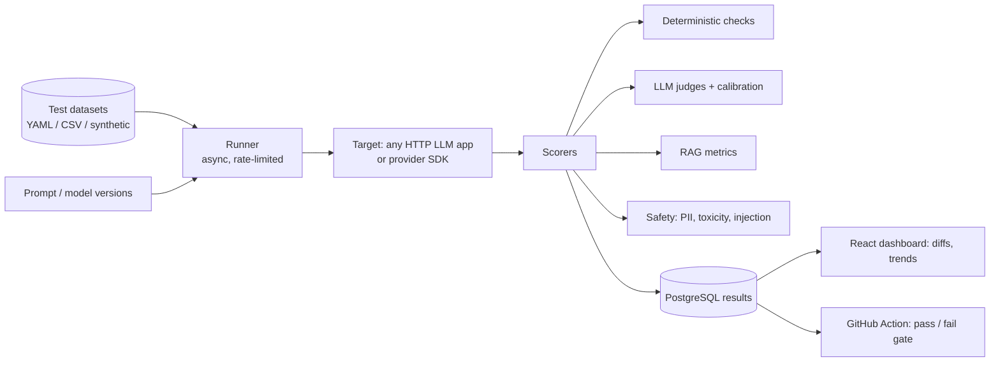

# Assay – LLM Eval

**An evaluation and guardrails platform for LLM apps: regression-test prompts, RAG pipelines and agents before every deploy**

Python · FastAPI · LLM-as-a-judge · RAGAS · OpenTelemetry · PostgreSQL · Redis · React · GitHub Actions · Docker

> **Status: under active development.** This README is the design spec. The checklist in the [Roadmap](#roadmap) shows what is built so far.

---

## Overview

Teams ship LLM features and only find out about regressions from users. Common causes are a prompt change that breaks tone, a new model version that hallucinates more, or a retriever change that drops recall.

Assay is the tool a forward-deployed engineer brings to a customer. You point it at an LLM endpoint, give it a dataset of test cases, and it:
- runs the cases against one or more models or prompt versions;
- scores them with deterministic checks (JSON schema, regex, exact match), **LLM-as-a-judge** rubrics with calibration, and RAG metrics;
- **fails the CI build** if quality, safety, cost or latency go past a threshold;
- shows side-by-side diffs between runs in a web dashboard.

## Architecture



## Key features

- **Pluggable targets:** OpenAI, Anthropic, Gemini, Azure OpenAI, Ollama, or any HTTP endpoint
- **Judge calibration:** judges are scored against human labels (Cohen's kappa), so their reliability is a measured number
- **Synthetic test generation:** expand 20 seed cases into hundreds of adversarial and edge-case variants
- **Red-team pack:** prompt-injection, jailbreak and PII-leak probes
- **Cost and latency budgets** per suite, with p50/p95 tracking
- **GitHub Action** that comments a score diff on every PR
- **OpenTelemetry** export, so results can sit next to existing traces

## Planned repository structure

```
assay-llm-eval/
├── assay/            # core: runner, scorers, judges, datasets
├── server/               # FastAPI results API
├── dashboard/            # React + Vite UI
├── action/               # GitHub Action wrapper
├── examples/             # sample RAG app + suites
├── tests/
└── .github/workflows/
```

## Roadmap

- [ ] Core runner + YAML suite format + CLI (`assay run`)
- [ ] Deterministic and RAG scorers
- [ ] LLM-as-a-judge with calibration against human labels
- [ ] Synthetic + red-team case generation
- [ ] Results API + PostgreSQL storage
- [ ] Dashboard with run diffs
- [ ] GitHub Action PR gate
- [ ] Case study: catching a real regression in the sample RAG app

## Author

**Hasan Mohd Hussain**: [GitHub](https://github.com/striderzz) · [LinkedIn](https://www.linkedin.com/in/hasan-m-4b1bba315/) · [Portfolio](https://striderzz.github.io/portfolio-website/)
